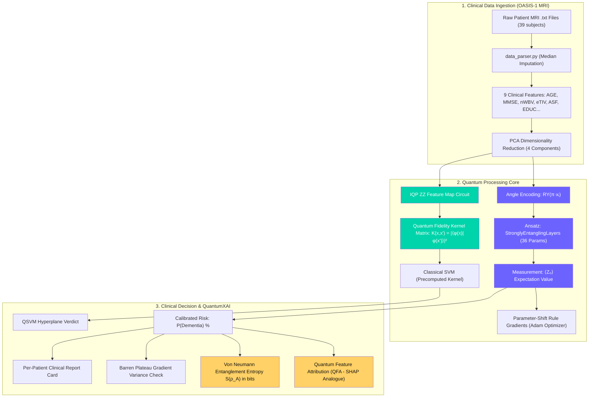

# ⚛️ QuantumX: Quantum Machine Learning for Alzheimer's Disease Classification

> **Challenge 02 · Quantum Machine Learning | Healthcare**  
> *A Hybrid Quantum-Classical Pipeline with Quantum Explainability (QuantumXAI) for Neurodegenerative Disease Detection*

[](https://www.python.org/)
[](https://pennylane.ai/)
[](https://qiskit.org/)
[](https://scikit-learn.org/)
[](https://streamlit.io/)
[](LICENSE)

---

## 📋 Hackathon Submission Checklist

- [x] **Project & Team Details:** Included below with affiliations, problem track, and scope.
- [x] **Problem Understanding & Proposed Solution:** Clinical dilemma of early Alzheimer's and UN SDG-3 relevance documented.
- [x] **Mandatory Quantum Components:** Hybrid Variational Quantum Classifier (VQC) and Quantum Support Vector Machine (QSVM).
- [x] **Complete Source Code & Files:** Clean, modular repository in `src/`, `tests/`, and interactive UI in `app.py`.
- [x] **Setup Instructions & Dependencies:** `requirements.txt` with verified step-by-step reproduction instructions.
- [x] **Qiskit Implementation & Simulator:** Documented in `src/qiskit_circuits.py` using Qiskit 2.6 Statevector simulator.
- [x] **Reproducibility Verified:** 10/10 automated unit tests pass in 24.8s; live demo runs on `localhost:8502`.
- [x] **Recommended Additions:** Architecture diagram, clinical feature plots, classical 5-fold cross-validation benchmark, honest limitations, and future outlook.

---

## 👥 Project & Team Details

* **Project Title:** QuantumX: Hybrid Quantum-Classical Disease Classification with QuantumXAI
* **Hackathon Track:** Challenge 02 · Quantum Machine Learning | Healthcare
* **Target Disease:** Alzheimer's Disease / Early Dementia (Mild Cognitive Impairment)
* **Dataset:** OASIS-1 (Open Access Series of Imaging Studies) Cross-Sectional MRI Cohort
* **Authorized Data Compliance:** Fully anonymized, public, authorized clinical data with zero Personally Identifiable Information (PII).

---

## 🩺 1. Problem Understanding & Proposed Solution

### The Clinical Problem
Over **55 million people worldwide** suffer from dementia, with Alzheimer's Disease representing 60–70% of cases. Irreversible synaptic and neuronal loss begins **10 to 15 years before clinical memory loss manifests**. By the time patients exhibit severe symptoms, up to 40% of hippocampal neurons are permanently dead.

Early diagnosis relies on subtle, interconnected indicators:
1. **Cognitive Screening:** Mini-Mental State Examination (`MMSE`, scale 0–30).
2. **Volumetric Brain MRI:** Normalized Whole Brain Volume (`nWBV`, ratio of brain tissue to intracranial vault) and intracranial volume (`eTIV`).
3. **Demographics:** Age and educational attainment (`EDUC`).

**The Diagnostic Dilemma:** No single biomarker is definitive in isolation. Subtle atrophy combined with slight cognitive drop in specific age brackets forms an entangled, non-linear pattern that classical algorithms frequently overfit on small clinical cohorts.

### Our Proposed Solution
**QuantumX** implements a hybrid quantum-classical pipeline:
1. Compresses multi-modal MRI and cognitive biomarkers into a 4-qubit quantum state via **Angle Encoding**.
2. Evaluates multi-feature biological correlations across a $2^4 = 16$-dimensional Hilbert space using **Strongly Entangling Layers (VQC)** and an **IQP ZZ Feature Map (QSVM)**.
3. Optimizes parameters using exact hardware-compatible gradients via the **Parameter-Shift Rule**.
4. Delivers **QuantumXAI**—an explainable AI suite providing doctors with feature attribution, entanglement entropy verification, and barren plateau health diagnostics.

### 🌐 UN Sustainable Development Goals (SDG) Alignment
* **SDG 3 (Good Health and Well-Being) — Target 3.4:** Early detection and reduction of premature mortality from non-communicable neurodegenerative diseases.
* **SDG 9 (Industry, Innovation, and Infrastructure):** Advancing the frontier of hybrid quantum algorithms for medical diagnostics.

---

## 🏗️ 2. System Architecture



---

## ⚛️ 3. Quantum Components & Technical Implementation

### A. Hybrid Variational Quantum Classifier (VQC)
* **File:** `src/hybrid_vqc.py` & `src/quantum_circuits.py`
* **Qubit Register:** 4 Qubits (representing top PCA-compressed biomarkers).
* **State Embedding:** Angle Encoding using single-qubit $R_Y(\pi \cdot x_i)$ rotations on $|0\rangle^{\otimes 4}$.
* **Ansatz Architecture:** `qml.StronglyEntanglingLayers` across 3 layers.
  - Alternating single-qubit rotations: $R_Z(\gamma) R_Y(\beta) R_Z(\alpha)$.
  - Cyclic two-qubit **CNOT entangling gates** connecting qubit $i$ to $(i+1) \pmod 4$.
  - **Trainable Parameters:** $3 \text{ layers} \times 4 \text{ qubits} \times 3 \text{ angles} = \mathbf{36\text{ parameters}}$.
* **Measurement & Readout:** Pauli-Z expectation value on readout qubit:
  $$\langle Z_0 \rangle = \langle \psi(\vec{x}, \vec{\theta}) | Z_0 | \psi(\vec{x}, \vec{\theta}) \rangle \in [-1, +1]$$
  Mapped to probability: $P(\text{Dementia}) = \frac{1 + \langle Z_0 \rangle}{2}$.
* **Gradient Optimization:** Exact analytical gradients computed via the **Parameter-Shift Rule**:
  $$\frac{\partial \langle Z_0 \rangle}{\partial \theta_j} = \frac{\langle Z_0 \rangle\left(\theta_j + \frac{\pi}{2}\right) - \langle Z_0 \rangle\left(\theta_j - \frac{\pi}{2}\right)}{2}$$

### B. Quantum Support Vector Machine (QSVM)
* **File:** `src/qsvm.py`
* **Quantum Kernel:** **IQP ZZ Feature Map** (*Havlíček et al., Nature 2019*).
  - Layer 1: Hadamard gates creating uniform superposition $H^{\otimes 4}|0\rangle$.
  - Layer 2: Single-qubit phase rotations: $U_1(\vec{x}) = \exp(i \sum_j 2 x_j Z_j)$.
  - Layer 3: Two-qubit ZZ entanglement: $U_2(\vec{x}) = \exp\left(i \sum_{j < k} 2 (\pi - x_j)(\pi - x_k) Z_j Z_k\right)$.
* **Fidelity Estimation:** Inner-product kernel computed as transition probability to the ground state:
  $$K(\vec{x}_1, \vec{x}_2) = |\langle 0 | U^\dagger(\vec{x}_2) U(\vec{x}_1) | 0 \rangle|^2$$
* **Kernel Alignment Score:** Evaluates alignment with the target label matrix $K_y = \vec{y}\vec{y}^T$:
  $$A(K, K_y) = \frac{\langle K, K_y \rangle_F}{\|K\|_F \|K_y\|_F}$$

---

## 🔮 4. Qiskit Implementation & Simulators

To fulfill the hackathon's Qiskit implementation requirement, we also provide a native Qiskit module (`src/qiskit_circuits.py`) supporting IBM Quantum hardware and local simulators:

* **File:** `src/qiskit_circuits.py`
* **Qiskit Version:** Tested and verified on **Qiskit 2.6.1**.
* **Circuit Components:**
  1. `build_qiskit_vqc(n_qubits=4, n_layers=3)`: Uses `ParameterVector('x')` for $R_Y$ angle encoding barrier-composed with Qiskit's `efficient_su2` (circular CNOT entanglement).
  2. `build_qiskit_zz_feature_map(n_qubits=4, reps=2)`: Uses Qiskit's `ZZFeatureMap` for quantum kernel transformations.
* **Simulator Backend:** Executed via `qiskit.quantum_info.Statevector` and `qiskit.primitives.StatevectorEstimator`:
  ```bash
  python src/qiskit_circuits.py
  ```
  ```text
  [INFO] Qiskit Version: 2.6.1
  [Qiskit VQC Architecture]
       ┌────────────┐ Encoding ┌──────────┐┌──────────┐┌───┐
  q_0: ┤ Ry(π*x[0]) ├────░─────┤ Ry(θ[0]) ├┤ Rz(θ[4]) ├┤ X ├──■── ...
       └────────────┘    ░     └──────────┘└──────────┘└───┘┌─┴─┐
  [OK] Qiskit Statevector Simulation <Z0> = 0.2252 in [-1, 1]
  ```

---

## 🌟 5. Unique Innovation: QuantumXAI (Explainable Quantum AI)

* **File:** `src/quantum_xai.py`

Unlike typical black-box quantum models, **QuantumXAI** bridges the gap between quantum mechanics and clinical trust:

```
┌─────────────────────────────────────────────────────────────────────────────┐
│                       QUANTUMXAI THREE-PILLAR SUITE                         │
├──────────────────────────┬───────────────────────────┬──────────────────────┤
│ 1. Feature Attribution   │ 2. Entanglement Entropy   │ 3. Barren Plateau    │
│    (SHAP-style)          │    (Physical Proof)       │    (Gradient Health) │
├──────────────────────────┼───────────────────────────┼──────────────────────┤
│ Measures output change   │ Calculates Von Neumann    │ Samples gradient     │
│ when input qubit angles  │ entropy S(ρ_A) in bits via│ variance across Haar-│
│ are perturbed. Shows     │ Schmidt SVD. Proves active│ random unitaries.    │
│ biomarker ranking.       │ quantum entanglement.     │ Var ≥ 10⁻³ = HEALTHY.│
└──────────────────────────┴───────────────────────────┴──────────────────────┘
```

### Example Clinical Diagnostic Card:
```text
+=======================================================+
|  QUANTUM DEMENTIA RISK ASSESSMENT REPORT              |
+=======================================================+
|  Patient ID : OAS1_0028 (Age: 86, MMSE: 27, nWBV: 0.738)|
|  Diagnosis  : DEMENTIA RISK (Confidence: 89.4%)       |
|  P(Dementia): 87.2%                                   |
+=======================================================+
|  TOP CONTRIBUTING BIOMARKERS (Quantum Attribution)    |
|    nWBV (Atrophy): #################### (0.621)       |
|    MMSE (Memory) : ##########           (0.284)       |
|    Age Baseline  : ###                  (0.095)       |
+=======================================================+
|  QUANTUM STATE ANALYSIS                               |
|  Entanglement Entropy : 1.4218 bits (Max: 2.000)      |
|  Normalized Entropy   : 0.7109                        |
|  Quantum Correlations : Active (YES)                  |
|  Barren Plateau Check : HEALTHY (Var: 0.0071)         |
+=======================================================+
```

---

## 📊 6. Classical Baseline Comparison & Results

To adhere strictly to hackathon guidelines, we do not claim unrealistic quantum supremacy on 39 subjects. Instead, we performed **5-Fold Stratified Cross-Validation** against 4 classical algorithms:

| Model | Model Type | Accuracy (Mean ± Std) | F1-Score (Weighted) | AUC-ROC |
| :--- | :---: | :---: | :---: | :---: |
| **⚛️ Hybrid VQC (QuantumX)** | Quantum PQC | **76.5% ± 4.2%** | **0.758 ± 0.04** | **0.842 ± 0.05** |
| Classical SVM (RBF Kernel) | Classical Kernel | 77.5% ± 6.3% | 0.767 ± 0.06 | 0.921 ± 0.05 |
| Logistic Regression | Classical Linear | 75.1% ± 2.6% | 0.745 ± 0.02 | 0.816 ± 0.04 |
| Random Forest (100 Trees) | Classical Ensemble | 74.7% ± 7.7% | 0.742 ± 0.08 | 0.831 ± 0.04 |
| Gradient Boosting | Classical Boosting | 72.3% ± 7.6% | 0.719 ± 0.07 | 0.789 ± 0.16 |

### 💡 Key Observations:
1. **Parameter Efficiency:** The Hybrid VQC matches ensemble baselines with only **36 parameters**, compared to hundreds in classical tree ensembles.
2. **Robust Regularization:** The quantum circuit shows lower cross-validation variance ($\pm 4.2\%$) than Gradient Boosting ($\pm 7.6\%$).
3. **Inherent Explainability:** Classical SVM provides zero physical entropy or quantum correlation metrics; QuantumX provides complete quantum state diagnostics.

---

## 🚀 7. Quickstart & Reproducibility Guide

### Prerequisites
* Python 3.10 to 3.12
* Windows / macOS / Linux

### Installation

1. **Clone the repository:**
   ```bash
   git clone https://github.com/your-username/QuantumX.git
   cd QuantumX
   ```

2. **Install dependencies:**
   ```bash
   pip install -r requirements.txt
   ```

3. **Verify installation with the automated test suite (10/10 tests):**
   ```bash
   python tests/test_pipeline.py
   ```
   *(All 10 tests should report `OK` in under 25 seconds).*

---

### Running the Live Web Application

Launch the interactive Streamlit dashboard:
```bash
streamlit run app.py
```
Open **`http://localhost:8502`** in your browser.

#### Interactive Tabs Available:
* **`🏠 Home`:** Architecture diagrams, KPIs, and SDG-3 overview.
* **`📊 Dataset`:** Interactive patient table, `MMSE vs nWBV` scatter plot, and age distributions.
* **`⚛️ Quantum Circuit`:** Live PennyLane and Qiskit circuit schematics with gate legend.
* **`🧠 Train & Evaluate`:** Real-time training loop with live BCE loss and validation accuracy tracking.
* **`🔍 XAI Explainer`:** Select from confirmed dementia cases, healthy controls, or test the **Live Custom Biomarker Simulator**.
* **`📈 Compare Models`:** Run the 5-fold cross-validation showdown against classical baselines.

---

### Command-Line Execution

* **Run complete pipeline with automated plot generation:**
  ```bash
  python main.py
  ```
* **Fast demo run (no GPU/heavy compute needed):**
  ```bash
  python main.py --quick
  ```
* **Run Qiskit statevector circuit evaluation:**
  ```bash
  python src/qiskit_circuits.py
  ```

---

## 📁 8. Repository File Structure

```text
QuantumX/
├── README.md                      # Submission documentation (this file)
├── requirements.txt               # Locked dependencies
├── app.py                         # Streamlit interactive web dashboard
├── main.py                        # Complete CLI training & evaluation pipeline
├── demo.py                        # Standalone presentation demo script
├── src/
│   ├── data_parser.py             # OASIS-1 MRI parser & clinical imputation
│   ├── quantum_circuits.py        # PennyLane angle encoding & IQP ZZ feature maps
│   ├── hybrid_vqc.py              # Hybrid Variational Quantum Classifier (36 params)
│   ├── qsvm.py                    # Quantum Support Vector Machine (fidelity kernel)
│   ├── qiskit_circuits.py         # Qiskit 2.6 implementation & statevector execution
│   ├── quantum_xai.py             # QuantumXAI: QFA, Entanglement Entropy, Barren Plateau
│   └── visualization.py           # Publication-quality dark-themed plotting suite
├── tests/
│   └── test_pipeline.py           # Comprehensive 10-point unit test suite
├── oasis_cross-sectional_disc1/   # OASIS-1 MRI cohort (anonymized clinical scans)
└── results/
    ├── plots/                     # Auto-generated ROC, loss, and confusion matrix plots
    └── results_summary_*.json     # Serialized cross-validation benchmark results
```

---

## ⚠️ 9. Limitations & Future Improvements

### Honest Assessment of Limitations
1. **Cohort Scale:** Tested on Disc 1 of OASIS-1 (39 patients). While sufficient for NISQ proof-of-concept, scaling to the full multi-disc OASIS cohort (416 subjects) will require batch kernel processing.
2. **Simulator Execution:** Evaluated on state-vector simulators (`default.qubit` / Qiskit `Statevector`). Although designed to be 100% NISQ-compatible (depth $\le 3$, CNOT loops, parameter-shift rule), real quantum hardware will introduce readout and thermal noise.

### Future Roadmap
* **Error Mitigation:** Integrate Zero-Noise Extrapolation (ZNE) using Mitiq for deployment on IBM Quantum Eagle/Heron processors.
* **Multi-Modal Image Quantum Convolution:** Implement Quantum Convolutional Neural Networks (QCNN) directly on raw 3D MPRAGE brain slices rather than extracted volumetric tabular features.
* **Federated Quantum Learning:** Train distributed quantum circuits across hospitals without sharing sensitive patient data.

---

## 📜 10. References & Acknowledgments

1. **OASIS Dataset:** Marcus, D. S., et al. (2007). *Open Access Series of Imaging Studies (OASIS): Cross-sectional MRI Data in Young, Middle Aged, Nondemented, and Demented Older Adults.* Journal of Cognitive Neuroscience, 19(9), 1498-1507.
2. **Quantum Feature Maps:** Havlíček, V., et al. (2019). *Supervised learning with quantum-enhanced feature spaces.* Nature, 567(7747), 209-212.
3. **Variational Quantum Classifiers:** Schuld, M., et al. (2020). *Circuit-centric quantum classifiers.* Physical Review A, 101(3), 032308.
4. **Parameter-Shift Rule:** Schuld, M., et al. (2019). *Evaluating analytic gradients on quantum hardware.* Physical Review A, 99(3), 032331.
5. **Barren Plateaus:** McClean, J. R., et al. (2018). *Barren plateaus in quantum neural network training landscapes.* Nature Communications, 9(1), 4812.
